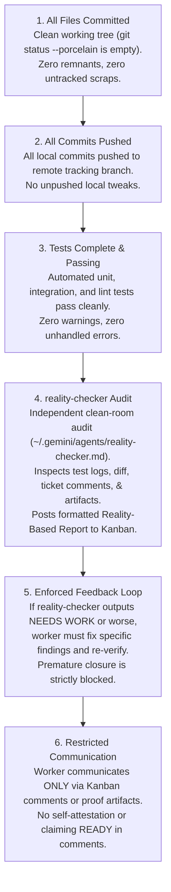

# CoSSH Kanban QA Protocol & Anti-Hallucination Gate

## 1. Purpose: Anti-Hallucination & Anti-Frustration Guardrail

The primary purpose of the QA Gate is to **prevent hallucinations** and neutralize the **"agent frustration metric"**—the known tendency of LLM coding agents to make partial or superficial tweaks after receiving feedback and prematurely mark tickets `Done` to bypass rigorous verification.

The QA Gate strips agents of the ability to self-certify. It ensures that work is mathematically and forensically proven before production transition.

---

## 2. The 6 Non-Negotiable QA Invariants

Before any Kanban ticket in CoSSH can transition to `Done`, it must fulfill these six criteria:

### Detailed Breakdown

1. **All Files Committed:**
   - The git working tree must be 100% clean (`git status --porcelain` returns nothing).
   - No leftover scratch scripts, temporary configs, or uncommitted modifications.

2. **All Commits Pushed:**
   - Remote tracking branch is completely up-to-date (`git log @{u}..HEAD` is empty).
   - Guarantees that what was verified locally is identically reflected on the remote repository.

3. **All Tests Complete and Pass:**
   - Automated quality control pipelines (`./gradlew test lint`) must execute without failures.
   - For UI changes: Paparazzi screenshot tests must be updated and passing.
   - For backend/logic changes: Unit tests covering happy and negative edge cases.

4. **Independent `reality-checker` Evaluation:**
   - The `reality-checker` agent runs as an out-of-band auditor (personality defined in `~/.gemini/agents/reality-checker.md`).
   - Inputs provided: automated test logs, source code diff, ticket description, acceptance criteria, and proof artifacts in `docs/qa/`.
   - Output: An official **Reality-Based Report** evaluating completeness, system evidence, quality ratings, and an unambiguous status (**READY** or **NEEDS WORK**).
   - The report is posted directly as a comment on the Kanban ticket.

5. **Enforced Feedback Loop (If `NEEDS WORK`):**
   - If `reality-checker` rejects the submission, the worker agent must read the report, address each deficiency in code/tests, commit, push, and request re-evaluation.
   - Circuit breakers and rate limits prevent brute-forcing repeated transitions without code changes.

6. **Restricted Communication Channels:**
   - The worker communicates with `reality-checker` **only** through comments on the Kanban ticket or via committed artifacts in `docs/qa/`.
   - Comments must be factual citations (e.g., *"See test run in docs/qa/SSH-152.md"* or *"Crash cannot occur because bounds are enforced at line 45"*).
   - Workers must never attempt to self-declare `READY` in comments; only the `reality-checker` report certifies production readiness.

---

## 3. Evidence Depot Guidelines (`docs/qa/`)

- `docs/qa/` is strictly a repository for **raw forensic artifacts** (test logs, logcat traces, benchmark metrics, screenshots).
- It is **not** a place for ticket management, planning notes, or conversation.
- Every artifact must be committed and pushed to git so that `reality-checker` and CI can independently audit it.
